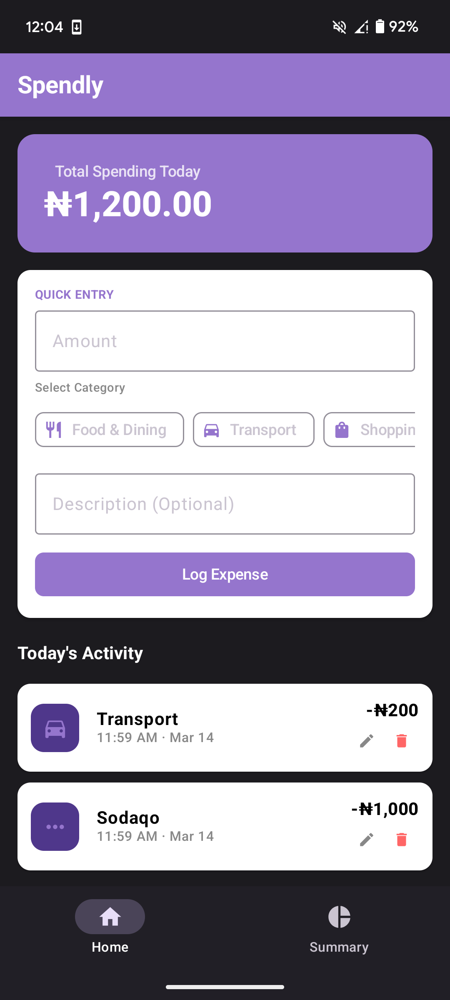
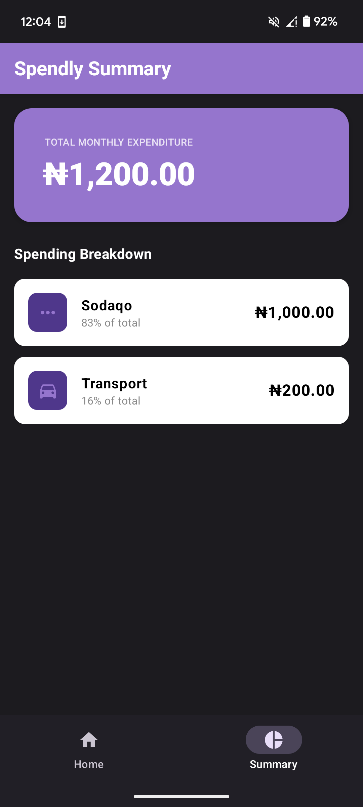

# Spendly 💸

Spendly is a modern, easy-to-use Android daily expense tracking application built using Kotlin and Jetpack Compose. It provides a sleek and intuitive interface to log daily expenses, track activity, and manage your budget effortlessly.

## 🚀 Features

*   **Quick Entry**: Rapidly log expenses with minimal taps and a beautiful UI.
*   **Daily Summary**: Get an instant overview of your total spending for the day.
*   **Categorization**: Organize expenses into predefined or custom categories with matching icons.
*   **Activity Logging**: View today's detailed activity with time stamps and descriptions.
*   **Edit & Delete**: Easily modify or remove previous expense logs.
*   **Modern UI Engine**: Built completely with Jetpack Compose featuring Material Design 3 and a clean color palette.

## 🛠️ Technology Stack

*   **Language**: Kotlin
*   **UI Framework**: Jetpack Compose (Material 3)
*   **Architecture Components**: ViewModel, StateFlow

## 📸 Screenshots

<div align="center">
  
  &nbsp;&nbsp;&nbsp;&nbsp;
  
</div>

## 🏃 Getting Started

1.  Clone the repository:
    ```bash
    git clone https://github.com/your-username/spendly.git
    ```
2.  Open the project in **Android Studio**.
3.  Build and run the application on an Android emulator or a physical device.

## 🤝 Contributing

Contributions, issues, and feature requests are welcome! Feel free to check the issues page.


