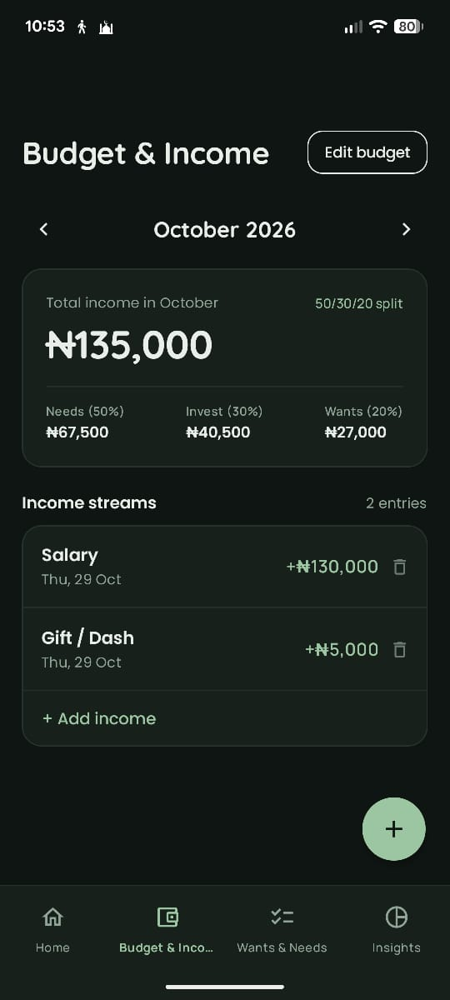
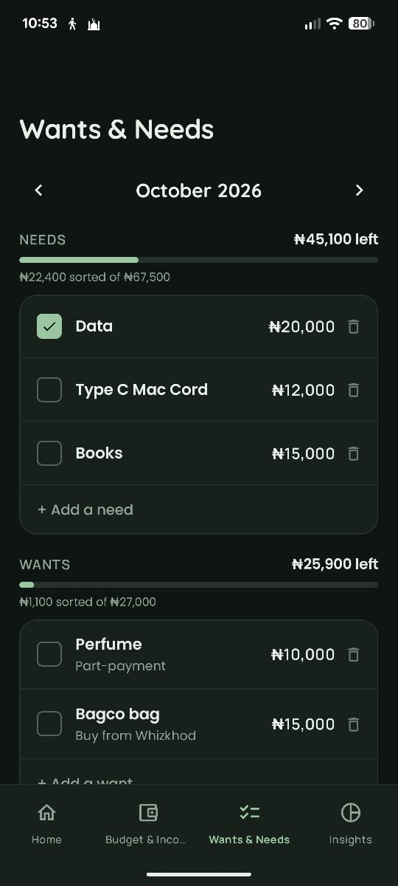
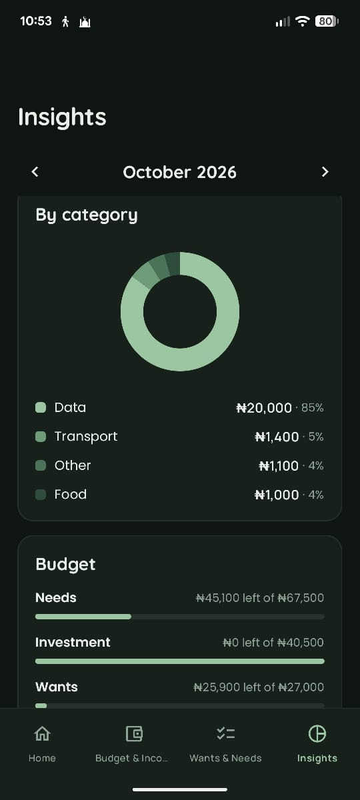

# Spendly

> A minimalist budget tracker I built for myself: sort your needs, set aside your investments, and plan your wants.

Spendly is a calm, personal space to track daily spending and plan each month without the clutter of traditional budgeting apps.

<p align="center">
  
  &nbsp;&nbsp;
  
  &nbsp;&nbsp;
  
  &nbsp;&nbsp;
  
</p>

---

## Why I built this

I started learning about personal finance last year after noticing that my salary rarely lasted until the end of the month. I realized I needed to track my daily expenses and have a simple place to list everything I planned to buy, rather than relying on notes and guesswork. Because existing apps were either too cluttered or too thin to plan a month with, I built Spendly around three goals:

1. **Log an expense in a few seconds**, so I actually do it every day.
2. **See the month at a glance**, without digging through menus.
3. **Plan the month with the 50:30:20 rule**, and tick things off as I sort them, so the budget updates as I go.

Because I am the only user I had to design for, I could make strong choices: no accounts, no bank syncing, no clutter, and amounts shown in naira (₦).

---

## What it does

### Features

| Feature | What it does |
| --- | --- |
| **Daily spending & past-day logging** | Track today's total on the home screen, or select any previous date from the calendar to view or log forgotten daily expenses. |
| **Welcome greeting & Islamic reminders** | Time-of-day greeting (`Good morning/afternoon/evening/night, Habeebah`) paired with soul-lifting Qur'an and Hadith quotes that rotate every 3 hours (or cycle on tap). |
| **Quick add keypad** | Log an expense or income using a custom number pad, category chips, date selector, and an optional note. |
| **Budget & Income screen** | Log multiple income streams as they come in (`Salary`, `Gift / Dash`, `Side Gig`, `Other`). Your monthly total and **50:30:20** (or custom ratio) split update automatically. |
| **Wants & Needs checklist** | A dedicated monthly checklist for Needs, Wants, and Investment. Add items, tick them off when sorted, edit or delete items with one tap, or carry over unsorted items from last month. |
| **Live budget tracking** | As you tick items off, each category updates in real time to show how much is left of its budget. |
| **Merged Insights & History** | One screen: this month's total, a category donut chart, 50:30:20 budget progress, and a list of past months with `% vs prev` badges. |
| **Light & Dark themes** | Warm beige with forest & sage accents in light mode, and deep forest with sage accents in dark mode. |
| **App icon** | A progress ring with a tick: a month getting sorted. |

---

## How the budget works

By default, Spendly uses the **50:30:20** rule (**Needs : Investment : Wants**), or you can switch to a **custom ratio** if you prefer your own percentage split:

- **50% Needs** (or custom %): rent, food, transport, data, anything you cannot skip
- **30% Investment** (or custom %): savings and investing, set aside first
- **20% Wants** (or custom %): things you would like but could live without

You can log individual income streams (`Salary`, `Gift / Dash`, `Side Gig`, `Other`) on the **Budget & Income** screen as money comes in—or set a monthly budget directly—and Spendly automatically calculates each bucket. Example with a monthly income of ₦120,000 on the default 50:30:20 split:

| Category | Share | Budget |
| --- | --- | --- |
| Needs | 50% | ₦60,000 |
| Investment | 30% | ₦36,000 |
| Wants | 20% | ₦24,000 |

**Left = budget minus the total of items you have ticked as sorted.**

If Rent (₦30,000) and Data (₦4,000) are ticked under Needs, you have sorted ₦34,000 and have ₦26,000 left of ₦60,000. Unticked items are planned, not spent, so they do not reduce what is left until you sort them.

---

## Screens

| Screen | Purpose |
| --- | --- |
| **Home** | Time-of-day greeting, rotating Islamic quote, date selector (today or any past day), daily progress bar, and transactions |
| **Budget & Income** | Total monthly income, live 50:30:20 / custom ratio split, `Edit budget`, and all logged income streams (`Salary`, `Gift / Dash`, `Side Gig`, `Other`) |
| **Wants & Needs** | The monthly checklist for Needs, Wants, and Investment, with remaining budget and one-tap delete |
| **Add / Edit sheet** | Amount first, date picker, number pad, category or income source chips, optional note |
| **Insights** | Month total, category donut chart, budget progress, past months |

Navigation has four tabs: **Home**, **Budget & Income**, **Wants & Needs**, and **Insights**.

---

## Design

Spendly is deliberately quiet. A few rules shaped every screen:

- **One job and one main action per screen.**
- **Amount first.** Adding an expense starts with the number, not a form.
- **Notes are optional and stay out of the way** until you tap them.
- **Consistent category colours**, with a legend, so charts never need guessing.
- **Warm neutrals & forest tones** instead of cold fintech blues.
- **The accent is used sparingly**: the add button, progress bars, checkboxes, and the active tab.

### Palettes

| Token | Light | Dark |
| --- | --- | --- |
| Background | `#F4EFE8` | `#0F1512` |
| Card | `#FBF8F3` | `#17201B` |
| Text | `#1A2B21` | `#E9EFE8` |
| Muted text | `#5C6B61` | `#8FA596` |
| Border | `#E4DCCF` | `#26322B` |
| Primary Accent | `#1A2B21` (forest) | `#9CC5A1` (sage) |
| Text on accent | `#FBF8F3` | `#0F1512` |

### Typography & Icon

- **Headings:** Quicksand (Medium, SemiBold, Bold)
- **Body & Titles:** Poppins (Regular, Medium, SemiBold)
- **Labels & Numbers:** Manrope (Regular, Medium, SemiBold, Bold)
- **App Icon:** Background `#1A2B21`, track `#2F4538`, ring `#9CC5A1`, tick `#E9EFE8`

---

## Tech stack

- **Language:** Kotlin (`2.0.21`)
- **UI toolkit:** Jetpack Compose (Material 3, custom Canvas donut charts & adaptive themes)
- **Local storage:** Room Database (`2.6.1`) & `SharedPreferences` (monthly budget plans)
- **Architecture:** MVVM (`ViewModel`, `StateFlow`, Repository pattern)
- **Navigation:** Jetpack Navigation Compose (`2.8.5`)
- **Min SDK / Target SDK:** Min SDK 24 (Android 7.0) · Target / Compile SDK 36

---

## Project structure

```text
Spendly/
├── app/
│   └── src/main/
│       ├── java/com/example/daily_expenses/
│       │   ├── data/
│       │   │   ├── local/        # Room Entity (Expense), ExpenseDao, SpendlyDatabase
│       │   │   ├── model/        # BudgetBucket (50:30:20), CategoryHelper, MonthlyAggregate
│       │   │   └── repository/   # ExpenseRepository
│       │   ├── ui/
│       │   │   ├── home/         # HomeScreen, IncomeScreen, WantsAndNeedsScreen, AddExpenseSheet, HomeViewModel
│       │   │   ├── summary/      # SummaryScreen (Insights), SummaryViewModel
│       │   │   ├── history/      # HistoryScreen, HistoryViewModel
│       │   │   └── theme/        # Color.kt, Theme.kt, Type.kt (Quicksand, Poppins, Manrope)
│       │   ├── MainActivity.kt   # 4-tab Scaffold & NavHost (Home, Budget & Income, Wants & Needs, Insights)
│       │   └── SpendlyApp.kt     # Application class
│       └── res/
│           ├── font/             # Quicksand, Poppins, and Manrope font resources
│           ├── mipmap-*/         # Adaptive, rounded, and monochrome launcher icons
│           └── values/           # Colors, strings, and themes
├── screenshots/                  # App screenshots for README
└── README.md
```

---

## Getting started

```bash
git clone https://github.com/habibatsulayman/spendly.git
cd spendly
```

1. Open the project in **Android Studio**.
2. Let Gradle sync dependencies.
3. Run the app on an Android device or emulator (API 24+).

---

## Privacy

All data stays locally on your device via Room and `SharedPreferences`. There are no accounts, cloud servers, analytics, or bank connections.

---

## Roadmap

- [x] Daily total and daily budget
- [x] Select any past date to view or log forgotten daily expenses
- [x] Time-of-day welcome greeting & 3-hour rotating Islamic quotes
- [x] Dedicated Budget & Income screen for multiple income streams (`Salary`, `Gift / Dash`, `Side Gig`, `Other`)
- [x] Monthly 50:30:20 & custom ratio budget screen
- [x] Wants & Needs checklist with notes and one-tap delete
- [x] Budget "left" figures that update as items are ticked
- [x] Merged Insights and History screen with category donut chart
- [x] Light & Dark themes (forest and sage)
- [x] Carry over unsorted items to the next month
- [x] Copy last month's budget

---

## Author

Built by **Habeebah Sulayman**, an Android and Kotlin Multiplatform Engineer in Nigeria.  
Portfolio: [habeebahsportfolio.netlify.app](https://habeebahsportfolio.netlify.app)
